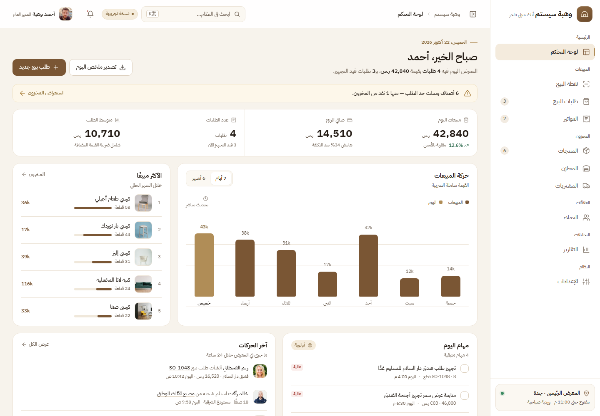
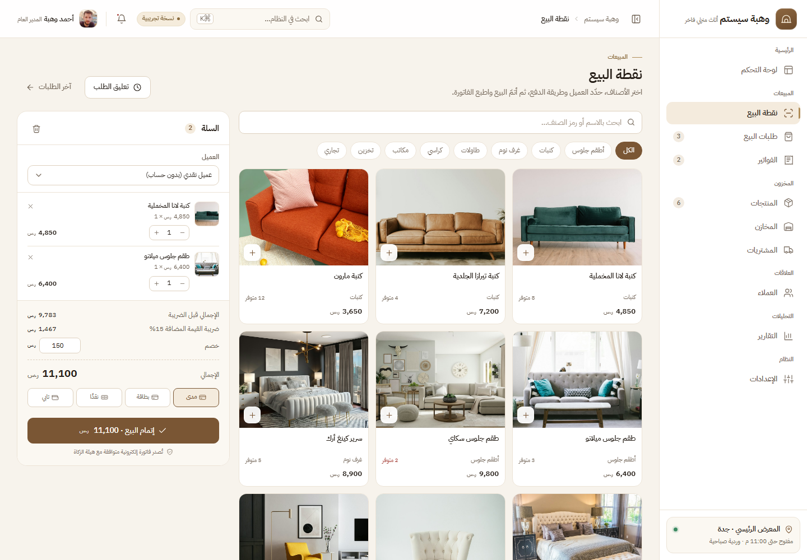

# وهبة سيستم — ديمو نظام ERP لمحل أثاث منزلي

نسخة عرض كاملة (ديمو) لنظام إدارة محل أثاث منزلي، بواجهة عربية RTL وهوية بصرية دافئة.
مبنية بدون أي خطوة بناء أو اعتماديات: HTML + CSS + JavaScript فقط، وكل شيء يعمل محليًا.

| لوحة التحكم | نقطة البيع |
| --- | --- |
|  |  |

---

## التشغيل

افتح `index.html` مباشرة في المتصفح، أو شغّل سيرفرًا محليًا بسيطًا:

```bash
python -m http.server 5173
# ثم افتح http://127.0.0.1:5173
```

> يفضّل السيرفر المحلي حتى تعمل كل المسارات والخطوط بدون قيود `file://`.

---

## الشاشات

| الشاشة | المسار | ما يمكن تجربته |
| --- | --- | --- |
| لوحة التحكم | `#/dashboard` | مؤشرات اليوم، رسم المبيعات (7 أيام / 6 أشهر)، الأكثر مبيعًا، المهام، آخر الحركات |
| نقطة البيع | `#/pos` | بحث وتصنيفات، سلة، خصم، طرق دفع، إتمام بيع فعلي وطباعة إيصال |
| طلبات البيع | `#/sales` | تصفية حسب الحالة، البحث، فتح الطلب ومساره الزمني |
| الفواتير | `#/invoices` | فاتورة ضريبية كاملة، تسجيل دفعة، طباعة |
| المنتجات | `#/inventory` | بحث/تصفية/ترتيب/ترقيم صفحات، تفاصيل الصنف، إضافة صنف جديد |
| المخازن | `#/warehouses` | سعة كل موقع، توزيع المخزون، نافذة تحويل |
| المشتريات | `#/purchases` | أوامر الشراء، الموردون، إنشاء أمر شراء |
| العملاء | `#/customers` | قائمة + ملف العميل، طلباته، رصيده |
| التقارير | `#/reports` | 7 أيام / 30 يومًا / 12 شهرًا، رسم بياني، توزيع الفئات، أداء الفروع |
| الإعدادات | `#/settings` | بيانات المتجر، الفروع، الضرائب، المستخدمون، الإشعارات |

إضافات على مستوى النظام:

- **بحث سريع** في كل شيء عبر `Ctrl K` / `⌘K` (شاشات، منتجات، عملاء، فواتير).
- **إشعارات** جاهزة في الجرس، و**دليل ديمو** عند الضغط على «نسخة تجريبية».
- **قائمة جانبية قابلة للتصغير**، وقائمة منزلقة على الجوال، وشريط سلة ثابت في نقطة البيع.
- **طباعة** الفواتير والإيصالات (تنسيق طباعة مخصص).
- كل التعديلات (بيع، صنف جديد، عميل، دفعة) تنعكس على الشاشات الأخرى داخل الجلسة.

---

## الهوية البصرية

- الاتجاه: **دفء فاخر** — عاجي دافئ، أبيض للبطاقات، بني جوزي أساسي، ولمسات نحاسية.
- خط واحد: **IBM Plex Sans Arabic** مستضاف محليًا في `assets/fonts` (يعمل دون إنترنت).
- بطاقات مسطّحة بحدود رفيعة، بلا ظلال داخل الصفحة؛ الظل محفوظ للنوافذ والطبقات العائمة فقط.
- **RTL** كامل باستخدام خصائص منطقية (`inset-inline`, `margin-block`, …).

### أين أغيّر الهوية؟

| ما تريد تغييره | المكان |
| --- | --- |
| اللون الأساسي / accent / الخلفيات | `assets/css/app.css` → كتلة `:root` (`--primary`, `--accent`, `--background`, …) |
| الخط | `assets/fonts/` ثم `@font-face` و`--font` في `app.css` |
| اسم المتجر وبياناته | `assets/js/data.js` → `DB.store` |
| العملاء والمنتجات والموردون | `assets/js/data.js` |
| الشعار (الماركة) | كتلة `brand-mark` في `index.html` + `openDemoGuide` (SVG) |

> ملاحظة: الصور في `assets/img` مأخوذة من Unsplash وrandomuser كصور عرض، وتُستبدل بصور المنتجات
> الحقيقية قبل التشغيل الفعلي.

---

## الوصولية

- تنقّل كامل بلوحة المفاتيح: حصر التركيز داخل النوافذ واللوحات، والإغلاق بـ `Esc` مع إعادة التركيز للعنصر الذي فتحها.
- تسميات `aria-label` لكل الحقول والأزرار الأيقونية، وبنية `dialog` / `listbox` صحيحة للبحث السريع.
- تباين النصوص الأساسية والثانوية لا يقل عن 4.5:1 على كل الشاشات.

---

## البيانات

- كل البيانات تجريبية ومحلية داخل `assets/js/data.js` — لا يوجد backend.
- التواريخ تُحسب نسبةً إلى تاريخ اليوم، لذا تبقى لوحة التحكم والتقارير «حيّة» في أي وقت.
- التغييرات تُحفظ في الذاكرة فقط وتُعاد عند تحديث الصفحة.
- من نافذة «نسخة تجريبية» يمكن إعادة تحميل البيانات فورًا.

---

## البنية

```
index.html
assets/
  css/app.css        # التوكنات + كل المكوّنات + التجاوب
  js/data.js         # البيانات التجريبية + دوال الحساب
  js/ui.js           # الأيقونات، القائمة، النوافذ، البحث السريع، الإشعارات
  js/pages.js        # شاشات النظام + تفاعلاتها
  js/app.js          # التوجيه، الهيكل، اختصارات الكيبورد
  fonts/             # IBM Plex Sans Arabic (woff2)
  img/               # صور المنتجات والفريق (محلية)
preview/            # لقطات الشاشة المستخدمة في README
```

---

## ملاحظات ديمو

- لا يوجد تسجيل دخول حقيقي أو صلاحيات مطبّقة؛ أدوار المستخدمين للعرض فقط.
- أزرار التصدير/الاستيراد تعرض تأكيدًا فقط، ولا تُنشئ ملفات.
- «إغلاق الوردية» و«تعليق الطلب» و«تعديل الصنف» تعرض رسالة توضيحية.
- الفوترة الإلكترونية والتكامل مع ZATCA محاكاة واجهة فقط.
- مُختبر على عرض 1440px وعلى 390px (جوال) بدون تمرير أفقي للصفحة.
